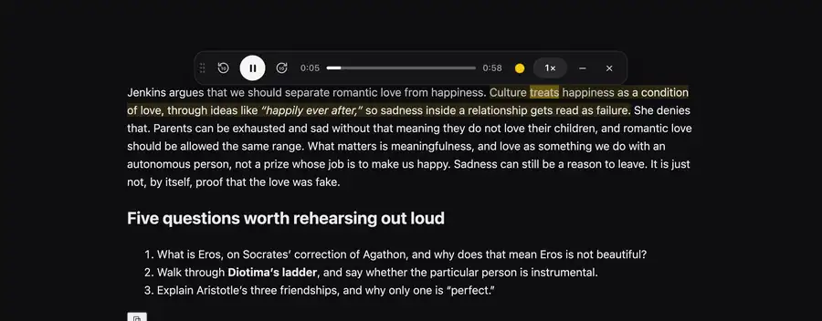

# Read Aloud Player for Grok

A Chrome extension (Manifest V3) that adds a floating audio player to Grok's **Read Aloud**: a seekable progress bar, ±10s skip, speed control from 0.5× to 3× with pitch preserved, and keyboard shortcuts.



## Install locally (2 minutes)

1. Open `chrome://extensions`
2. Turn on **Developer mode** (top right)
3. Click **Load unpacked** and pick this `grok-read-aloud-player` folder
4. Open grok.com, then click **Read aloud** on any response. The player appears near the top of the page.

## Controls

| Action | Mouse | Keyboard |
|---|---|---|
| Play / pause | ▶ button | `Alt/Option + K` |
| Back / forward 10s | ⟲10 / ⟳10 | `Alt + J` / `Alt + L` |
| Seek | click or drag the bar (hover shows the time) | focus bar, then `← →` (5s), `PgUp/PgDn` (30s), `Home/End` |
| Speed | speed button menu, or scroll wheel on it | `Alt + [` / `Alt + ]` |
| Move player | drag the ⋮⋮ grip (the position is remembered) | |
| Minimize | `–` turns it into a progress-ring button | |
| Hide | `×` hides it until the next read aloud | |
| Jump to a word | `Alt/Option`-click any word in the message being read | |
| Highlight colour | the coloured dot: yellow, green, blue, pink, orange, purple, or no highlight | |
| Word highlight on/off | | `Alt + H` |

Your chosen speed is remembered and applied to every new read aloud.

## On grok.com

The bar docks beside Grok's own read-aloud pill (`⏸ Voice 1x ✕`), nudging the pill right so the two sit centered together, matches its colors in light and dark mode, and hides when Grok's pill goes away. Grok's pill keeps play/pause and stop; this bar adds seek, ±10s and finer speeds. Speed changes made with Grok's `1x` button are picked up too.

**How seeking works:** Grok streams read-aloud audio from `/http/app-chat/read-response-audio-file/{id}` with no length and no range support, so the browser can't seek it. Even Grok's internal skip function does nothing. The extension downloads the same file in the background with your session and decodes it as it arrives. For AAC or MP3 audio it feeds the download into a MediaSource, so skips and scrubbing land exactly anywhere already downloaded, without restarting playback. For other formats it plays from WAV copies of the downloaded part. Skipping past what has downloaded goes as far as it can and keeps playing; the bar's lighter fill shows that limit. Pausing also moves playback off Grok's stream, which goes stale during long pauses. `__grokPlayerDebug()` reports which path is in use.

**Word highlighting:** the word being spoken is highlighted in the message (with its sentence shaded lightly), and the page scrolls to follow it unless you've scrolled in the last few seconds. Grok's audio has no word timings, so the extension builds them. It weights each word by its syllables, finds the silences in the audio (re-analysed every ~1.5s while it downloads), then runs one global best-fit alignment that matches sentence and clause breaks to those silences. A stretch that doesn't fit, such as text that isn't read aloud, is written off instead of throwing off everything after it. On test audio with known timings it stays within about 0.1s. It uses the CSS Custom Highlight API, so Grok's page markup is never changed.

## How it works

`content.js` runs in the page's own JS world at `document_start`, before Grok's code loads. It hooks the three ways a site can play speech:

- **`HTMLMediaElement.play()`**, which covers `new Audio()`, `<audio>`, and streamed MediaSource audio, including elements that are never added to the DOM. This path gets full seek and speed control. While audio is still streaming, the length shows as `1:23+`.
- **Web Audio `AudioBufferSourceNode.start()`** for chunked streaming TTS. This path gets progress plus pause and resume only. Seek and speed are disabled because buffers are scheduled ahead of time.
- **`speechSynthesis.speak()`** for browser TTS. This path supports pause and resume, speed, and seek, which restarts speech from the nearest word.

The UI lives in a closed shadow root, so Grok's CSS can't affect it and the player's CSS can't leak into Grok. On x.com it only activates under `/i/grok`. The extension uses no permissions, no network requests, and no data collection. The only thing it stores is your speed and player position, in `localStorage`.

## Publish to the Chrome Web Store

1. Pay the one-time $5 developer registration at https://chrome.google.com/webstore/devconsole
2. **New item**, then upload `grok-read-aloud-player.zip` (rebuild it with the command below)
3. Listing:
   - **Category:** Productivity → Tools
   - **Single purpose:** "Adds playback controls (seek bar, skip, speed) to Grok's Read Aloud audio."
   - **Host permission justification:** "Content script must run on grok.com (and x.com/i/grok) to attach the player to Read Aloud audio. No data is read or transmitted."
   - **Data usage:** check *none*. It collects no user data.
   - **Screenshots:** 1280×800. Take them on grok.com with the player visible.
4. Don't use "Grok" as the leading word of the name or in the icon. "Read Aloud Player *for* Grok" is the safer pattern for trademark review.

Rebuild the zip:

```bash
cd "/Users/oats/AAA Claude Capabilities/grok-read-aloud-player" && rm -f grok-read-aloud-player.zip && zip -r grok-read-aloud-player.zip manifest.json content.js icons
```

## Test page

`test/index.html` loads `content.js` directly and simulates each audio path (`new Audio`, MediaSource, Web Audio chunks, speechSynthesis). Serve the folder with `python3 -m http.server 3041` and open `/test/`.
